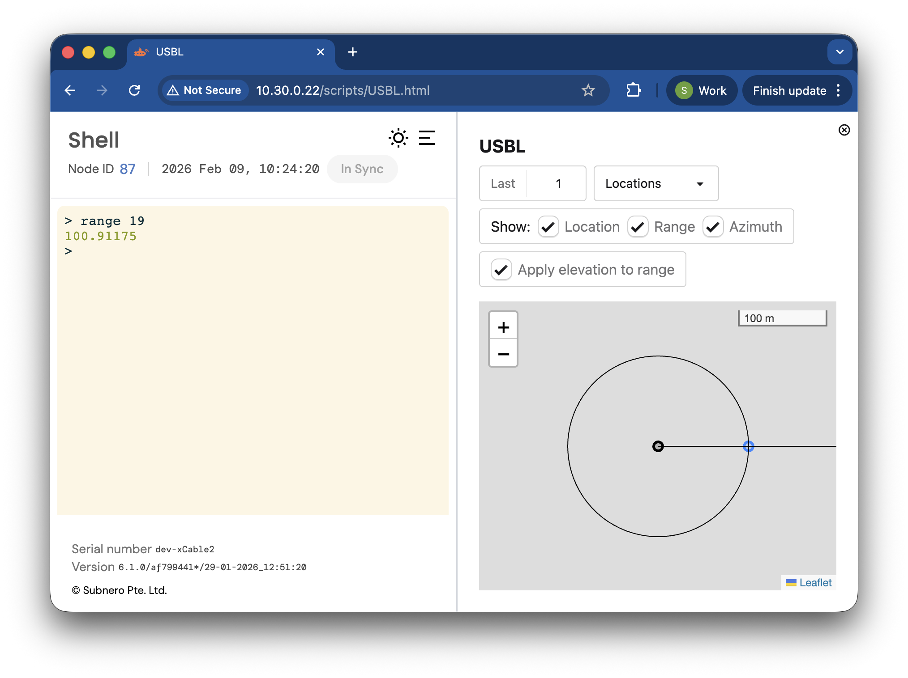

# USBL Demo

Turn your UnetStack multi-receiver modem into a USBL transceiver!

## Setup

1. Download the code, using `git` or [this link](https://github.com/org-arl/unet-contrib/archive/refs/heads/master.zip).
2. Install the dependencies using `./install`. This will install the [juliaup](https://github.com/JuliaLang/juliaup) version manager, the [Julia](https://julialang.org/) v1.12.4 runtime and a couple of Julia packages.
3. Save your receiver geometry to a text file, with one line per receiver and whitespace separated xyz coordinates in meters on each line (see [`geometry.txt`](https://github.com/org-arl/unet-contrib/blob/master/contrib/usbl/geometry.txt) for an example).

## Usage

1. Run `./usbl <modem-address> <geometry-file>` (e.g. `./usbl 192.168.42.123 geometry.txt`).
2. Run the following on the Unet shell:

   ```groovy
   > subscribe ranging
   > subscribe topic("bearings")
   > subscribe topic("locations")
   > range 2;
   usbl-script >> BearingNtf:INFORM[azimuth:5.322475759063779E-16 elevation:-5.051187579317586 rxStartTime:162525959]
   usbl-script >> BearingNtf:INFORM[azimuth:5.322475759063779E-16 elevation:-5.051187579317586 rxStartTime:164021959]
   ranging >> RangeNtf:INFORM[from:1 to:2 range:100.91175 offset:3610 rxStartTime:162525959]
   usbl-script >> PeerLocationNtf:INFORM[rxStartTime:162525959 peerLocation:100.519854,0,-8.884846 peer:2]
   ```

## USBL UI

On your transceiver modem:

1. Upload [`ui/dist/USBL.html`](https://github.com/org-arl/unet-contrib/blob/master/contrib/usbl/ui/dist/USBL.html) to the `scripts/` folder.
2. Refresh the UI, then go to Dashboards > USBL.html

<div style="text-align: center">

</div>

## VirtualAcousticOcean Test Environment

Run the following to test your setup in a [VirtualAcousticOcean](https://github.com/org-arl/VirtualAcousticOcean.jl) simulation.

```bash
# Abstract command
./vao <transceiver-address> <transponder-address>
# Concrete example
./vao 192.168.42.123 192.168.42.45
```

A USBL geometry file for this simulation is provided in [`geometry.txt`](https://github.com/org-arl/unet-contrib/blob/master/contrib/usbl/geometry.txt).
